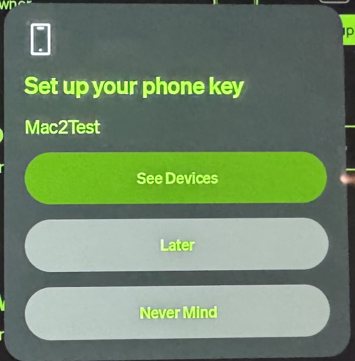
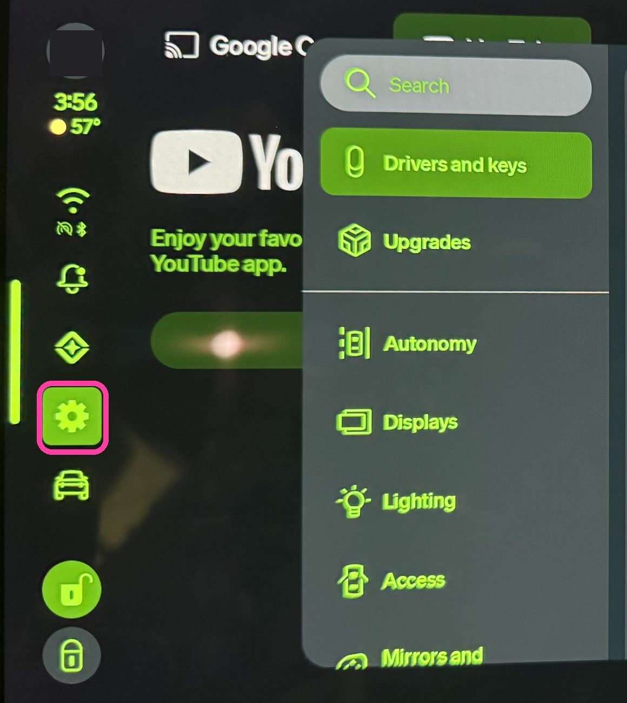
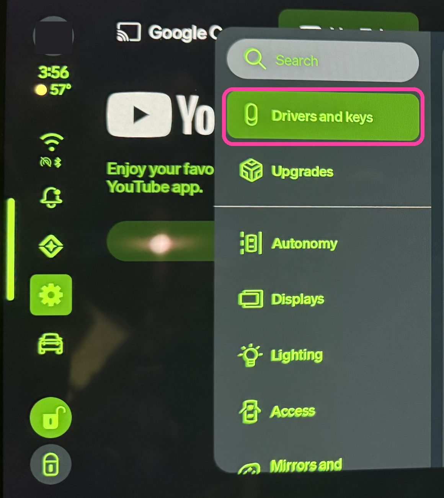
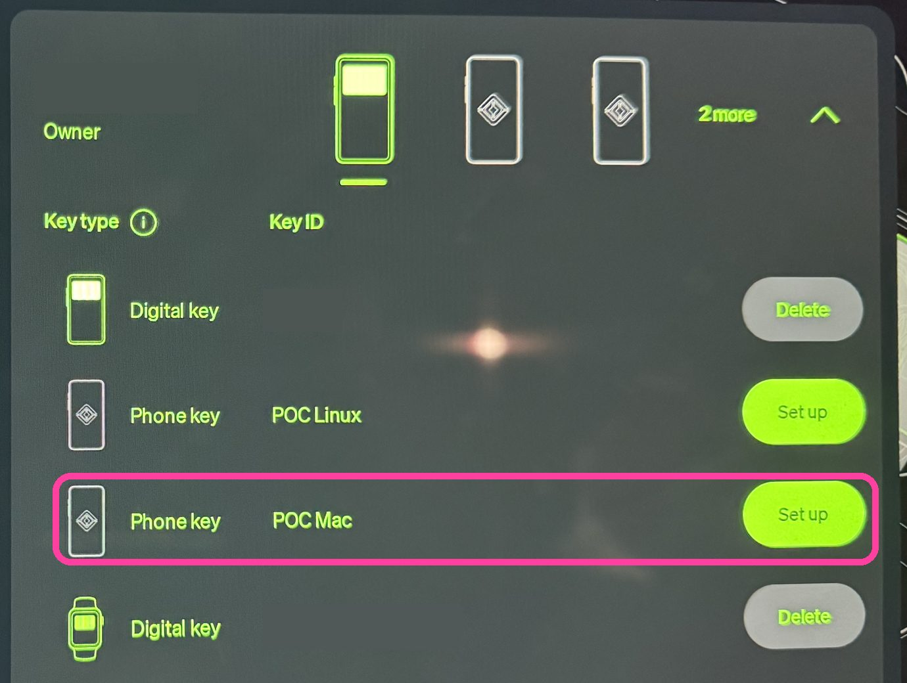
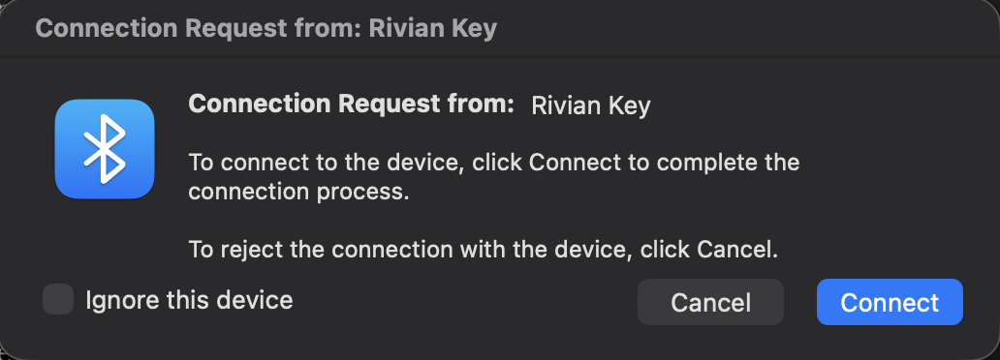
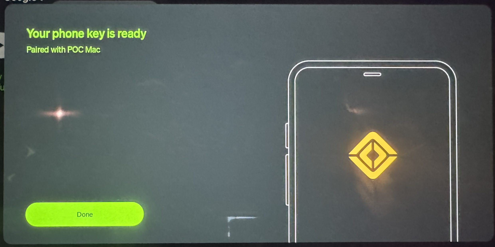

# rivian-gen2-key-poc

This is a proof of concept that allows a **Mac (or [Linux computer](#linux)) to link to a
Gen 2 Rivian** (R1S / R1T) so you can send it remote commands.

Remote commands (lock/unlock, windows, precondition, etc.) are sent over the Rivian GraphQL
API, but need to be signed with your generated key. The signature is an **HMAC-SHA256** of
the command name and timestamp, using a shared secret derived from your private key and
the vehicle's public key through ECDH and HKDF-SHA256.

Once you have linked your generated key to the Rivian **one time over Bluetooth**, you can
send signed API requests **over the internet — no Bluetooth required anymore** for those
remote commands. This uses the older, pre-CCC **Phone key** system, rather than a CCC
Digital Key such as an iPhone or Apple Watch wallet key.

This project uses [rivian-python-client](https://github.com/bretterer/rivian-python-client)
and grew out of work on Gen 2 pairing for the
[Home Assistant Rivian integration](https://github.com/bretterer/home-assistant-rivian)
([pairing discussion](https://github.com/bretterer/home-assistant-rivian/issues/181)).
The Bluetooth pairing handshake is documented in [PROTOCOL.md](PROTOCOL.md).

> **Proof of concept.** Tested on one 2026 R1S. Please [report your results](#report-your-results), good or bad.
> Unofficial; not affiliated with Rivian. Use at your own risk.

## What you need

- A Gen 2 R1S or R1T, and its owner or driver account
- A free **Phone key** slot. Each vehicle allows 4 keys of this type (shown as "Phone key" under
  *Drivers and keys*), shared by all drivers. Digital keys (iPhone / Apple Watch / Android wallet)
  and key cards don't count toward it. `enroll` checks this for you.
- A Mac sitting in or next to the vehicle, with **Python 3.11 or newer**. The `python3` that comes
  with macOS (via Xcode) is 3.9, which is too old. Install a current one with
  [Homebrew](https://brew.sh): `brew install python`

## Steps

**1. Check your Python** (needs 3.11 or newer):

```bash
"$(brew --prefix)/bin/python3" --version
```

If that says 3.11 or higher, continue. If `brew` isn't found or the version is older, install
[Homebrew](https://brew.sh) and run `brew install python`, then check again. (Plain `python3` on a
Mac is usually Apple's 3.9, which is too old.)

**2. Install** (once):

```bash
git clone https://github.com/walthowd/rivian-gen2-key-poc && cd rivian-gen2-key-poc
"$(brew --prefix)/bin/python3" -m venv .venv
source .venv/bin/activate
pip install -r requirements.txt
```

Opening a new terminal later? Run `source .venv/bin/activate` in the folder again first.

**3. Run guided setup:**

```bash
python rivian_key.py
```

Setup signs in if there is no saved session, asks for a key name if you have no local key
(or yours was removed from the vehicle),
and checks the existing key's status. With several local keys, it asks which to use.
It offers to pair when needed: **sit inside the vehicle with your Mac** before accepting.
You can decline and run the same command later to resume.

After pairing, setup checks status for up to a minute and reports success only when the key
is both paired and enabled. It then offers an optional menu of test commands (wake, lock,
unlock, windows open/close, honk); nothing is sent until you select it. If setup fails, it
points to redacted debug logs and the repository's issue page. A saved session that has
expired can be replaced with `python rivian_key.py login` before rerunning setup.

For multiple vehicles, use `python rivian_key.py setup --vehicle NAME` when enrolling.
You can also use `setup --key NAME` or `setup --token` (paste a session token when sign-in
is needed). The individual `login`, `enroll`, `pair.py`, `status`, and `command` commands
remain available.

**4. Follow the pairing prompts.**

It tells you what to do on the vehicle's screen (the vehicle must be awake):

- Right after setup creates the key, the vehicle pops up **Set up your phone key** with its name.
  Tap **See Devices**, pick your driver, then find the key (next step).

  

  No pop-up (e.g. you dismissed it, or the key was created earlier)? Tap **Settings** (the gear
  icon), then **Drivers and keys**:

  
  

- Find the phone key with your name (here "POC Mac") and tap **Set up**. Then press Enter on the Mac.

  

- A few seconds later macOS asks to connect. **Click Connect.**

  

- The vehicle confirms:

  

If Set up times out (about a minute), tap **Try again** and accept setup's retry prompt
(or run `python pair.py` again).
Pairing this Mac again (e.g. after `remove`)? First forget "Rivian Key …" in System Settings → Bluetooth; `pair.py` warns you if you forgot.
If macOS asks whether your terminal may use Bluetooth, allow it.

**5. Check it and try a command:**

```bash
python rivian_key.py status            # PAIRED (can take a minute to show)
python rivian_key.py command honk
```

## Commands

```bash
python rivian_key.py command --list           # every command; * = seen working on a Gen 2 vehicle
python rivian_key.py command unlock
python rivian_key.py command precondition_temp 21
python rivian_key.py command cabin_hvac_left_seat_heat 3
```

Seen working: `lock`, `unlock`, `windows_open`, `windows_close` (and `wake` is accepted). The
rest come from rivian-python-client and haven't been tried with this POC yet; please report. If the vehicle is asleep, send `wake` first.

### Navigation

Start navigation on the vehicle, or send a whole trip with charging stops. These only need a
signed-in session (not a paired key), and wake the vehicle if it is asleep.

```bash
python rivian_key.py navigate "Arrowhead Stadium"                                          # one destination
python rivian_key.py trip --dry-run "Arrowhead Stadium" "44.9737,-93.2581=U.S. Bank Stadium"  # plan and show only
python rivian_key.py trip "Arrowhead Stadium" "44.9737,-93.2581=U.S. Bank Stadium"            # send the trip
python rivian_key.py trip --add "40.9640,-91.5510=Coffee stop"                               # add as the next stop
python rivian_key.py trip --add "Arrowhead Stadium" --at end                                 # or as the last stop (or --at 2, …)
python rivian_key.py trip --end                                                            # stop navigating
```

A place is one of:

| You type | Meaning |
|---|---|
| `"Arrowhead Stadium"` | a saved or recent location by name: the list the Rivian app keeps (favorites and places you navigated to) |
| `Home`, `Work` | your saved home / work |
| `"44.9737,-93.2581=U.S. Bank Stadium"` | coordinates, with an optional name after `=` |
| a Google Maps share link | `navigate` only |

There is no search by name yet. For coordinates, right-click the spot in Google Maps (or press
and hold on a phone) and copy the `lat, lng` shown. Once you've navigated somewhere, it is a
recent location and works by name.

`trip` replaces any trip the vehicle is navigating. It sends the stops the way the app's trip
planner does; the vehicle plans the route and charging stops itself (minimum arrival charge `--arrive`, default 20%). Before sending it shows
Rivian's plan as a preview; afterwards it prints the route and charging stops the vehicle
actually planned. `--add` reads the stops of the trip the vehicle is navigating (started here, in
the app or on the vehicle), inserts the new places (next by default, `--at end` or `--at N`)
and sends the result. Each command waits
until the vehicle itself reports the change, usually within 30 seconds; `navigate` and `trip`
re-send if the vehicle missed it (it sometimes does while falling asleep).

### Halloween (Ghostbusters costume)

When the vehicle offers the seasonal Ghostbusters mode:

```bash
python rivian_key.py halloween on                     # / off
python rivian_key.py halloween show ecto1             # ecto1, proton, slimer, trap, random
python rivian_key.py halloween show slimer --motion   # play when someone walks by
python rivian_key.py halloween sound 2                # the 8 sound-effect buttons, 1-8
python rivian_key.py halloween music wraith           # ghostbusters, wraith, spirits, off
python rivian_key.py halloween volume 20
python rivian_key.py halloween lights on              # spooky overhead lights
```

Tested on the vehicle: on/off, the Ecto-1 and Slimer shows, sounds 1 and 2, music (Ghostbusters,
Wraith Hunt, off) and volume. The other shows, sounds and "Spirits" use the same numbering as the
buttons on the vehicle's screen but weren't individually tried; `lights` changes the setting
but had no visible effect while we tested.

To remove the key: `python rivian_key.py remove` (then forget "Rivian Key" in Bluetooth settings).

## Home Assistant users

- **Skip the password:** copy `user_session_token` from the `rivian` entry in HA's
  `/config/.storage/core.config_entries`, then run `python rivian_key.py login --token` and paste it.
- **Experimental: pair HA's own key**, so HA's lock/unlock/climate controls start working.
  Turn on *Vehicle control* in the HA Rivian integration, copy `core.config_entries` to your Mac, then
  `python rivian_key.py import-ha core.config_entries` and `python pair.py`.
  HA registers its key as type "HA", not "phone", and that hasn't been tested yet. Please report what happens.

## Linux

Works too, but needs root and changes Bluetooth adapter settings. See [LINUX.md](LINUX.md).

**Why Linux is harder (a vehicle quirk).** When a computer connects, it normally asks the vehicle
to send "my services changed" alerts. The vehicle refuses that request. Phones and Macs shrug it
off. Linux's Bluetooth system (BlueZ) treats it as fatal and hides all of the vehicle's services,
so normal Bluetooth libraries (including the one Home Assistant uses) see an empty device. To get
around it, the Linux version here talks to the vehicle directly over a raw Bluetooth connection
instead of going through BlueZ. A small fix in BlueZ (ignore that refusal) would remove the need
for this. It is the first known obstacle to pairing straight from Home Assistant (there may be others).

## Report your results

Open an [issue](https://github.com/walthowd/rivian-gen2-key-poc/issues/new) with your vehicle
(model, year, software version), macOS version, and the setup log plus the log
file from `logs/` that `pair.py` mentions. Logs are detailed but have tokens, keys, IDs, VINs,
names and addresses removed, so they're safe to attach.

## Keep `keys/` private

`keys/` holds your Rivian session and your private key. Anyone with them can command your vehicle.
It's excluded from git. Don't share it.

---

MIT license. Uses [rivian-python-client](https://github.com/bretterer/rivian-python-client).
The protocol was worked out for interoperability, by studying the official Android app, testing
against the vehicle, and an over-the-air capture of the app pairing. No Rivian code is included.
Rivian is a trademark of Rivian Automotive, LLC.
